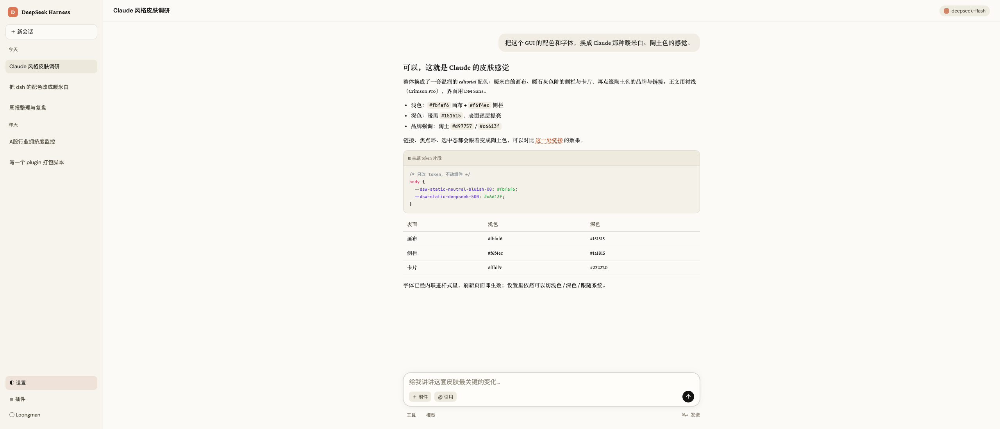
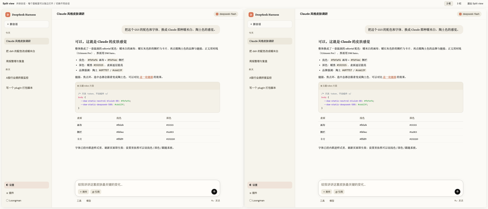
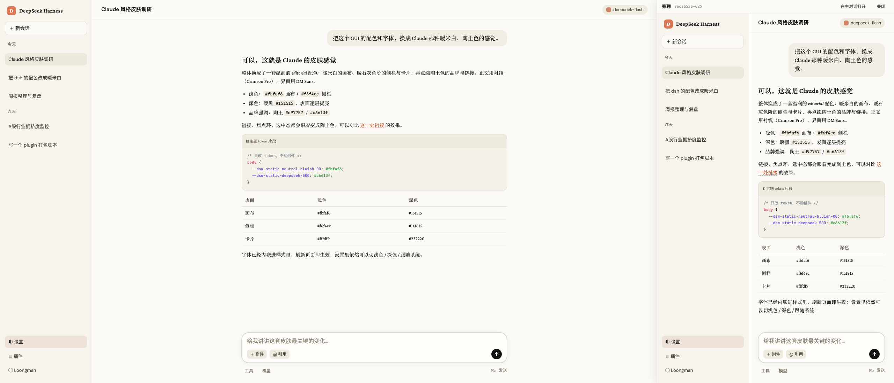
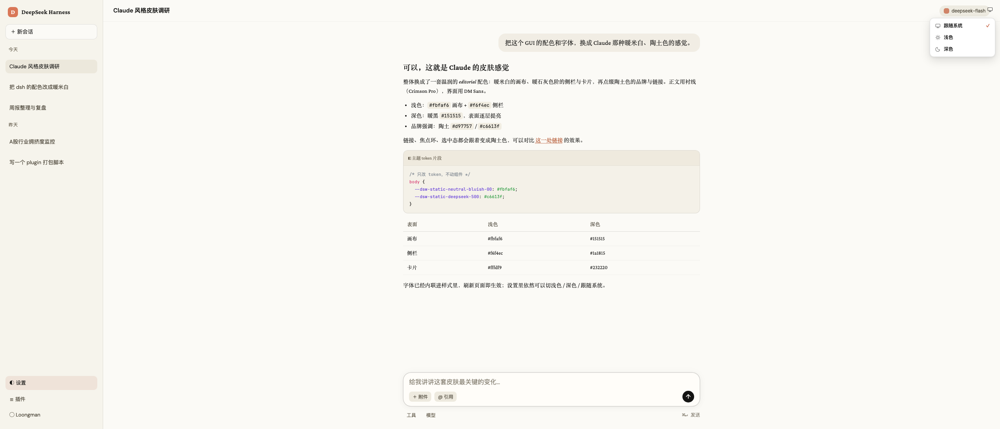

# dsh-claude-workbench

 

A Claude-flavoured workbench enhancement for the **DeepSeek Harness (DSH)** Web GUI — one plugin, five features:

1. **Claude skin** — warm cream canvas, warm stone surfaces and clay accents; serif **Crimson Pro** prose / **DM Sans** UI (fonts inlined, works offline), complete light/dark/system support.
2. **Split view** — the “◫ Split view” pill at the bottom-right splits the window into 2–3 full DSH panes, each with its own session view (the same idea as Claude’s Split view).
3. **Side chat** — select text in a conversation → right-click → **“在旁聊中提问”**; a docked right-hand panel boots a fork of the current session with the selection quoted in the composer. Closing archives the fork.
4. **Quick appearance switch** — a theme button at the top-right of the session header toggles follow-system / light / dark (same as Settings → General → Appearance, persisted).
5. **Completion chime** — a short, crisp chime when a turn finishes (like OpenCode’s completion sound); toggle it in the appearance menu and the choice is remembered. (0.1.3 fixes the status subscription that never fired.)

> Preview images are **synthetic renders** (plugin styles + mock data), not real conversations.

## Install

Desktop (Electron) uses the `desktop` profile — **do not** use `dsh plugin --profile web`.

- Ask DSH: *“install dsh-claude-workbench with plugin_manager”*, or
- In the app: Plugins → “Add plugin” → `dsh-claude-workbench` → enable → fully quit and reopen the client.

Web (`dsh web`): `dsh plugin --profile web add dsh-claude-workbench`, restart the host, then `Ctrl+F5`.

From source: `dsh plugin --profile web add github:<owner>/dsh-claude-workbench`.

## Compatibility

- DSH **0.2.x** (developed and verified on desktop `0.2.2-rc.1`);
- Uses the DSH client-plugin mechanism (`dsh.client` manifest + `window.__ModuleLoader__`).

## Customize

Edit `src/theme.css` (tokens/fonts) or `src/panes-ui.js` (UI), then `node tools/build.mjs` and reload. Disabling the plugin restores the stock UI; DSH itself is never modified.

## Known limits

- Panes/side chat run extra same-origin GUI clients inside the window; each pane is a full UI (with sidebar) and costs memory.
- Side chat requires a completed turn to fork; closing archives the fork (recoverable from Archived).
- A few rules depend on hashed class names of the current DSH build; they silently no-op after a breaking upgrade.

## License

Code MIT (`LICENSE`). Crimson Pro / DM Sans are SIL OFL 1.1 (`THIRD_PARTY_NOTICES.md`). Claude-inspired, unofficial, not affiliated with Anthropic; no Anthropic assets are included.
