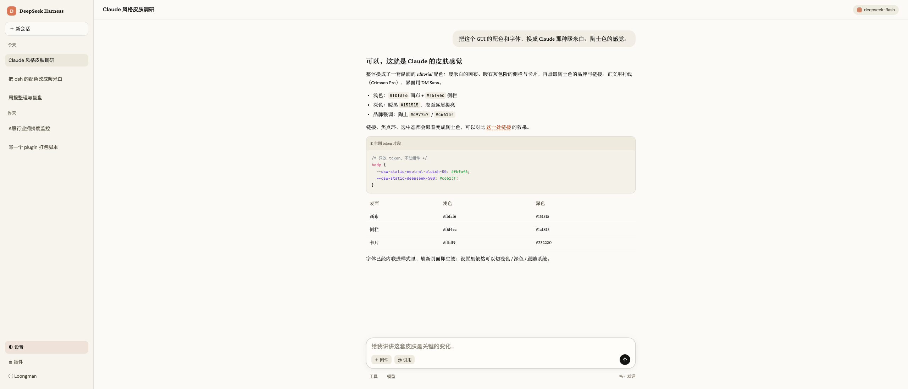
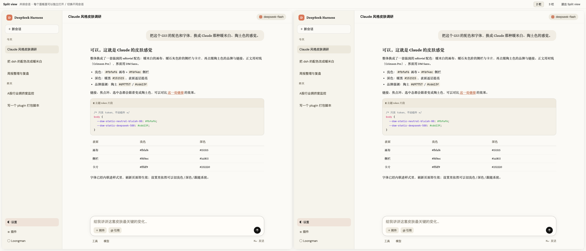
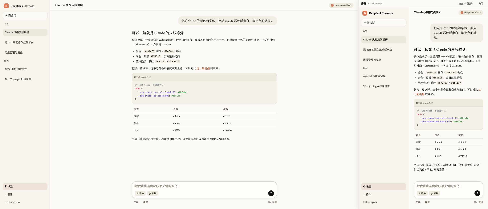
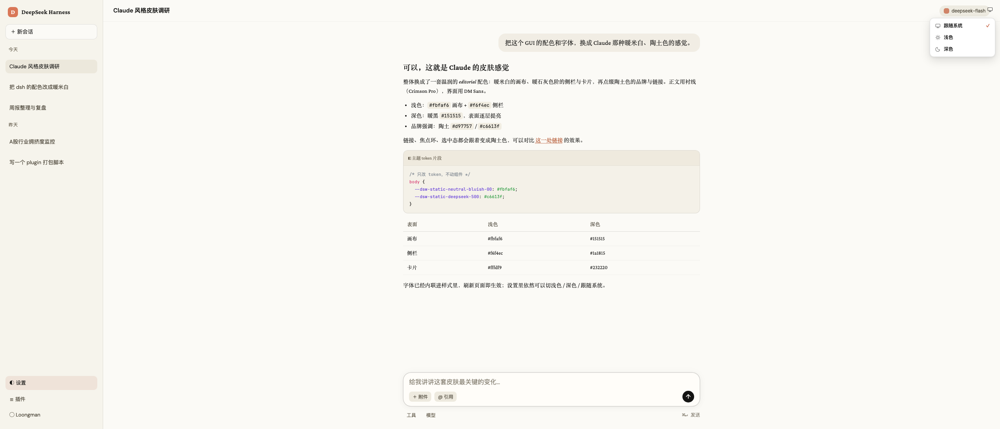

# dsh-claude-workbench

[](https://www.npmjs.com/package/dsh-claude-workbench) [](LICENSE)

给 **DeepSeek Harness（DSH）Web GUI** 的 Claude 风格工作台增强包 —— 一个插件，五件事：

1. **Claude 皮肤**：暖米白画布 + 暖石灰 + 陶土色，正文/标题用衬线 **Crimson Pro**、界面用 **DM Sans**（字体已内联，离线可用），浅色/深色/跟随系统都完整适配；
2. **Split view（并排会话）**：右下角「◫ Split view」→ 把窗口切成 **2 栏或 3 栏**，每栏是一个完整 DSH 界面，可各自打开/切换不同会话（对应 Claude 里的 Split view）；
3. **旁聊（side chat）**：在对话里**选中文字 → 右键 → 「在旁聊中提问」**，右侧 dock 出当前会话的 fork（继承上下文），选中的内容以引用形式预填进输入框；关闭时自动归档该 fork；
4. **外观快切**：右上角主题按钮，一键在 **跟随系统 / 浅色 / 深色** 之间切换（与「设置 → 通用 → 外观」等价、持久化）；
5. **完成提示音**：一轮对话结束时播放一声清脆提示音（类似 OpenCode 的完成提醒），可在右上角外观菜单里开关，设置会记住。






> 预览图是**模拟渲染**（用插件实际样式 + 假数据截图），不是真实会话；真实界面里的配色/字体/控件一致。

## 安装

### 官方桌面端（Electron）

桌面端读的是 `desktop` profile，**不要**用 `dsh plugin --profile web ...`。用宿主内置的插件管理：

- 在会话里对我说：**"用 plugin_manager 安装 dsh-claude-workbench"**；或
- 手动：插件页 →「添加插件」→ 输入 `dsh-claude-workbench` → 安装 → 按提示启用 → **完全退出客户端再打开**。

### Web 版（`dsh web`）

```bash
dsh plugin --profile web add dsh-claude-workbench
```

装完重启 host，浏览器 `Ctrl+F5`。

### 从 GitHub 源码

```bash
dsh plugin --profile web add github:<owner>/dsh-claude-workbench
```

## 用法

- **Split view**：点右下角「◫ Split view」→ 默认 2 栏；顶部可切 2/3 栏、退出；每栏像平常一样点左侧会话列表即可显示不同对话。
- **旁聊**：选中对话内容 → 右键 →「◧ 在旁聊中提问」；面板左缘可拖动调宽；「在主对话打开」把 fork 提为主对话；关闭自动归档 fork。
- **外观**：会话 header 右上角按钮（右侧栏展开按钮左边），点开选 跟随系统/浅色/深色；菜单里还有「完成提示音」开关。
- **完成提示音**：默认开启；对话完成（运行中 → 空闲）时响一声；子代理会话不响。

## 兼容性

- 适配 DSH **0.2.x**（在桌面版 `0.2.2-rc.1` 上开发与验证）；
- 依赖 DSH 客户端插件机制（`dsh.client` 清单 + `window.__ModuleLoader__`）；
- DSH 升级后若 token 名变化，个别颜色可能失效；欢迎提 issue。

## 自定义

```bash
# 改配色/排版：编辑 src/theme.css，然后
node tools/build.mjs     # 生成 lib/skin.css（字体内联）与 lib/client.js
```

- `src/theme.css`：颜色 token / 字体 / 字号的覆盖层
- `src/panes-ui.js`：Split view、旁聊、外观快切的浏览器端 UI
- 停用插件即完全还原，不改 DSH 本体。

## 已知限制

- Split view/旁聊本质是"在窗口里跑多份同源 GUI 客户端"，每栏是完整界面（含侧栏），内存占用随栏数增加；
- 旁聊需要当前会话至少有一个已完成轮次（fork 限制）；关闭默认归档 fork（可在"已归档"找回）；
- 少数样式用了 DSH 当前构建的哈希类名（消息气泡衬线、对话列宽），升级后匹配不到会静默跳过；
- 外观快切按钮挂在会话 header，全局面板（插件/设置页）没有该 header。

## 许可与声明

- 代码：MIT（见 `LICENSE`）；
- 字体：Crimson Pro / DM Sans，SIL OFL 1.1（见 `THIRD_PARTY_NOTICES.md` 与 `assets/fonts/OFL-*.txt`）；
- 设计灵感来自 Claude（Anthropic）；本项目为独立社区作品，**非官方、与 Anthropic 无关联**，不包含 Anthropic 的任何素材。
